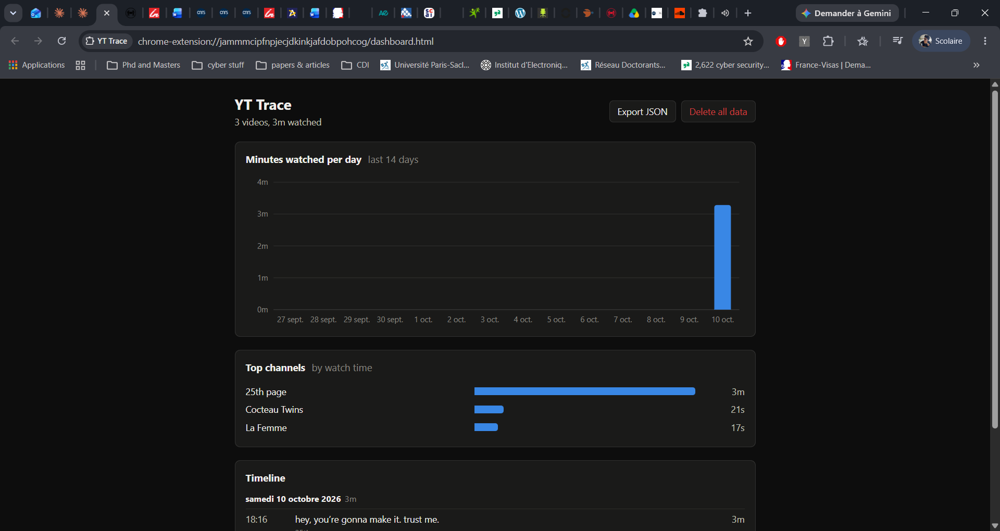
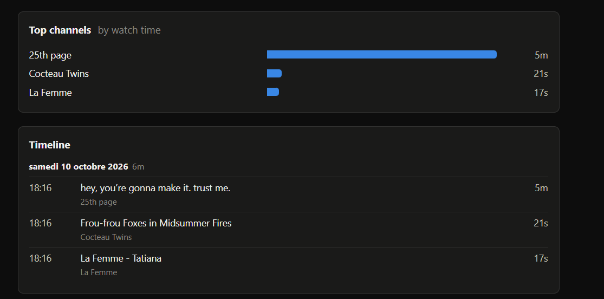

# YT Trace

[](https://github.com/rihemakkari/yt-trace/actions/workflows/ci.yml)

A small Chrome extension (Manifest V3) that records **your own** YouTube watch
history in your browser and shows it as a timeline and a chart.

## Privacy

Your data never leaves your browser.

- Everything is stored in `chrome.storage.local`, on your machine, in your
  Chrome profile.
- The extension makes no network requests. There is no server, no account, no
  analytics and no telemetry.
- It loads no remote code: no CDN scripts, fonts or images.
- The only way data leaves the extension is the **Export JSON** and
  **Export CSV** buttons, which save a file to your own disk.
- **Delete all data** removes every recorded watch. Uninstalling the extension
  removes it too.

You can check this yourself: the manifest asks only for the `storage`
permission and a content script on `www.youtube.com`, and the source has no
`fetch`, `XMLHttpRequest` or `WebSocket` calls.

## What it does

- Records each video you watch on `www.youtube.com`: video ID, title, channel,
  start time and the seconds it was actually playing.
- Ignores watches shorter than 10 seconds.
- Dashboard (toolbar icon → **Open dashboard**) with:
  - a timeline grouped by day, newest first,
  - minutes watched per day for the last 14 days,
  - top 5 channels by watch time,
  - **Export JSON**, **Export CSV** and **Delete all data** buttons.

## Screenshots

| Dashboard | Popup |
| --- | --- |
|  |  |

## Build and install

You need a current LTS release of [Node.js](https://nodejs.org).

```sh
git clone https://github.com/rihemakkari/yt-trace.git
cd yt-trace
npm install
npm run build
```

This writes the extension to `dist/`. To load it:

1. Open `chrome://extensions` in Chrome.
2. Turn on **Developer mode** (top right).
3. Click **Load unpacked** and pick the `dist/` folder.
4. Refresh any YouTube tabs that were already open.

Watch a video for at least 10 seconds, then click the YT Trace toolbar icon
and **Open dashboard**.

### Development

- `npm run watch` rebuilds the scripts on change.
- `npm run typecheck` runs the TypeScript compiler (esbuild does not type-check).
- `npm test` runs the Vitest unit tests for `src/stats.ts` and the CSV export.
- `npm run lint` runs ESLint with typescript-eslint.

CI runs all of these and the build on every push and pull request, and
uploads `dist/` as a build artifact.

After a rebuild, click the reload icon for YT Trace on `chrome://extensions`
and refresh open YouTube tabs.

## Permissions

- `storage`, to keep the history locally.
- A content script on `https://www.youtube.com/*`.

Nothing else.

## How watch time is counted

- Wall-clock time while the video is playing, so 10 minutes at 2x speed counts
  as 10 minutes. Pauses, buffering and seeking add nothing.
- Time is not counted while an ad is showing.
- Every navigation to a video starts a new entry; replaying in place extends
  the current one.
- Shorts, hover previews, embedded players and `music.youtube.com` are not
  tracked.

## Data format

Each watch is stored under its own key, `w:<id>`:

```ts
interface Watch {
  id: string; // `${startedAt}-${videoId}`
  videoId: string;
  title: string;
  channel: string;
  startedAt: number; // epoch milliseconds
  secondsWatched: number;
}
```

**Export JSON** saves `yt-trace-YYYY-MM-DD.json`:
`{ "version": 1, "exportedAt": "<ISO date>", "watches": Watch[] }`.

**Export CSV** saves `yt-trace-YYYY-MM-DD.csv`, one row per watch, newest
first:

```csv
video_id,title,channel,started_at,seconds_watched
dQw4w9WgXcQ,"Rock, ""Paper"" & more",Chaîne,2026-10-18T14:30:00.000Z,125
```

- `started_at` is ISO 8601 in UTC; `seconds_watched` is a whole number.
- Encoded as UTF-8 with a byte order mark, so Excel shows accented characters
  correctly. Lines end in CRLF.
- Fields are quoted per RFC 4180 when they contain a comma, double quote or
  line break, and double quotes inside them are doubled.
- A title or channel that starts with `=`, `+`, `-`, `@` or a tab gets a
  leading `'` so spreadsheets treat it as text, not a formula.

## Project layout

```
src/
  manifest.json
  types.ts        Watch type and export format
  storage.ts      the only module that touches chrome.storage.local
  stats.ts        pure functions for grouping and totals
  stats.test.ts   unit tests for stats.ts
  content.ts      watch tracker that runs on YouTube
  popup/          toolbar popup
  dashboard/      dashboard page, SVG chart and CSV export
build.mjs         esbuild script, outputs to dist/
```

Title and channel are read from YouTube's page markup. If YouTube changes it,
the selectors to update are at the top of `src/content.ts`.

## License

[MIT](LICENSE)
